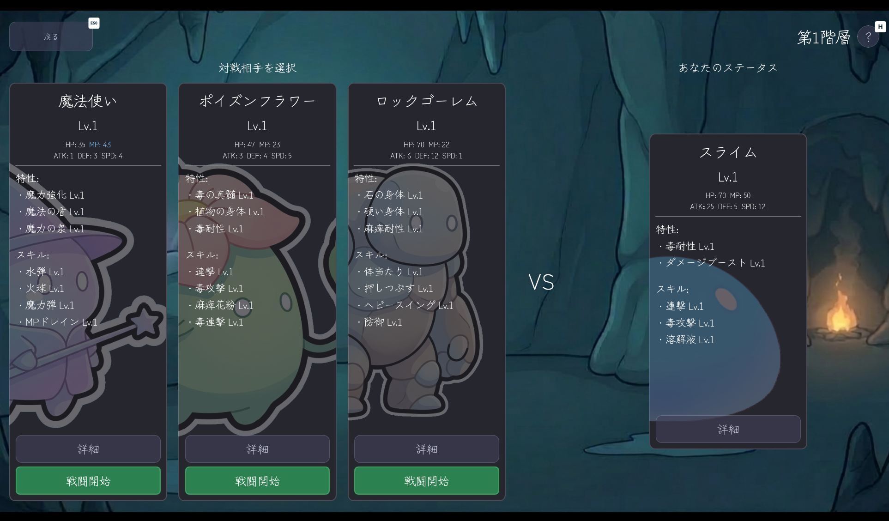
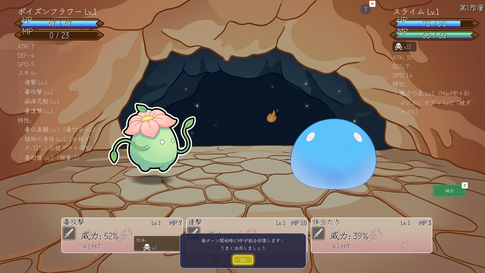
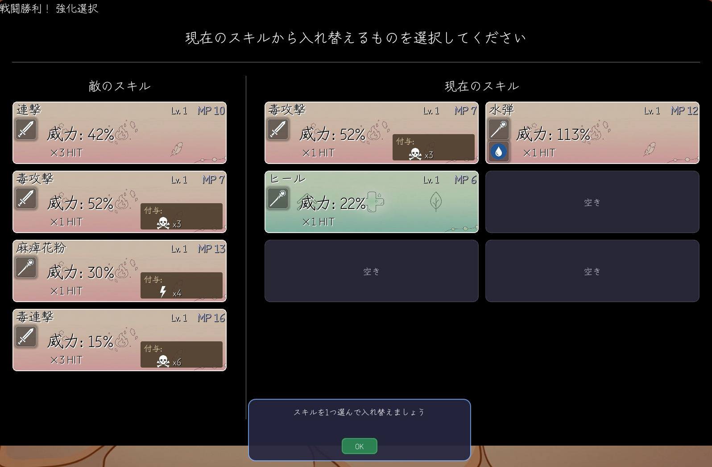

ブラウザ向けローグライク『Rogue Like Slime』をリリースしました！

## どんなゲーム？

敵の能力を吸収して強くなる、1対1のターン制バトルが楽しめるローグライクゲームです。

最初は弱いスライムですが、倒した相手のスキルや特性を吸収して強くなれます。
相手選びとビルド（構成）の組み合わせが攻略の鍵になる、手軽に遊べるゲームです！

## ギャラリー

敵の能力をうまく組み合わせて、自分だけの最強スライムを目指しましょう！


  
  
  


## ゲームの魅力
- **能力吸収でパワーアップ**：倒した相手のスキルを奪って、次の戦いに活かせるのが楽しい！
- **自分だけのビルド構築**：スキルの入れ替えや特性の組み合わせで、自分だけの最強スライムを考えよう！
- **手軽だけど奥が深い**：ルールはシンプルですが、ビルドや強さと相談しながら敵を選ぶ判断がクセになります

## 遊び方
画面に出てくる対戦相手を選んでバトル！
勝利したら好きな能力を選んで吸収し、さらに強い敵に挑んでいきましょう！
チュートリアルも付いているので、初めての方でも安心して遊べます。

## スペック
- **ジャンル**: ローグライクゲーム
- **対応言語**: 日本語・英語
- **価格**: $1~ (無料体験版あり)

## ダウンロード・販売ページ
以下のプラットフォームで公開・販売中です！

- **Itch.io** (ブラウザ版/PC版): [Rogue Like Slime](https://uni-yo-kan.itch.io/rogue-like-slime)
- **DLsite** (PC版): [Rogue Like Slime](https://www.dlsite.com/ai/work/=/product_id/RJ01599431.html)
- **BOOTH** (ブラウザ版/PC版): [Rogue Like Slime](https://uni-yo-kan.booth.pm/items/8196229)

---
何かご質問などありましたら、[uni.yokan00@gmail.com](mailto:uni.yokan00@gmail.com) までお気軽にご連絡ください！
