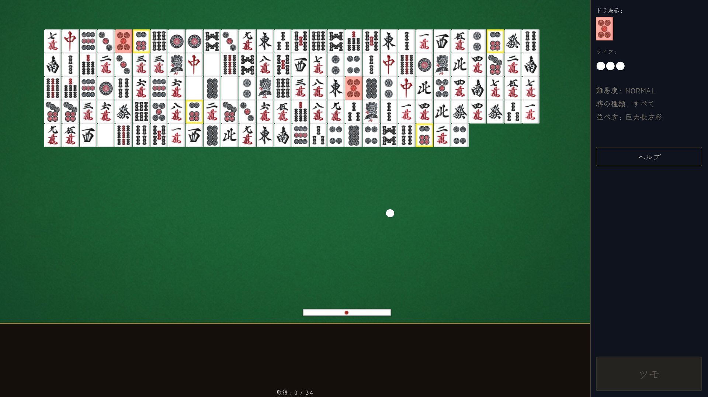
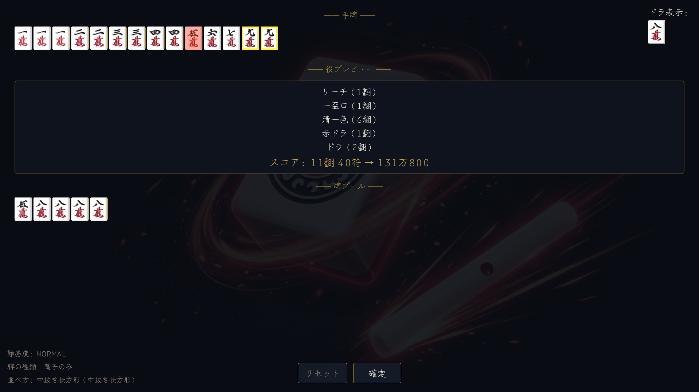
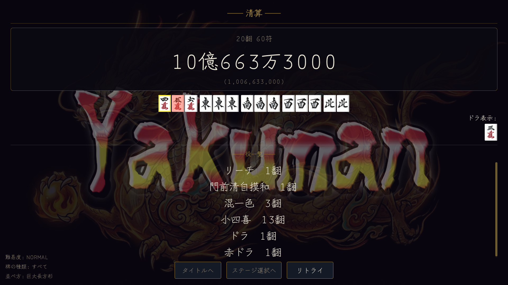
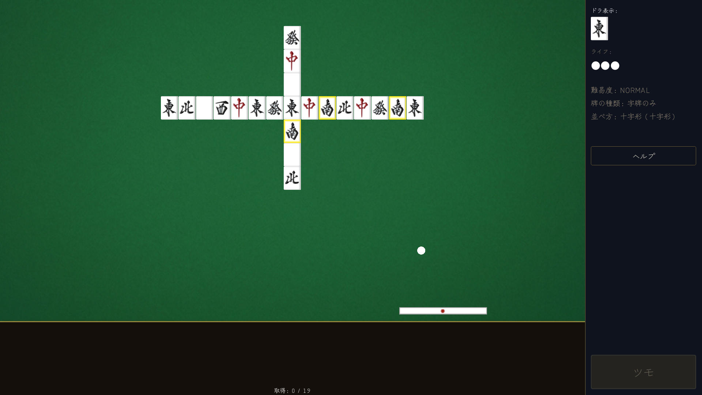

ブロック崩しと麻雀を組み合わせた一人用パズルアクション『牌崩し』をSteamでリリースしました！

[Steam：牌崩し](https://store.steampowered.com/app/4831470/_/)

## どんなゲーム？

ボールを打ち返してフィールドの麻雀牌を崩し、当てた牌を集めて役を作るゲームです。

集められる牌の枚数には限りがあるため、ただすべてを崩すのではなく、作りたい役を考えながら欲しい牌を狙うことがハイスコアへの近道です。

## ギャラリー

牌を狙うブロック崩しから14枚を選ぶ手作り、青天井スコアの清算まで、ひと続きで楽しめます。


  
  
  
  


## ゲームの魅力

- **欲しい牌を狙い撃ち**：ボールの軌道を読み、作りたい役に必要な牌を狙って集めます。
- **得点計算は青天井**：役満でも点数は上限で止まりません。大きな役とドラを重ねて、桁違いのスコアを目指せます。
- **多彩なルールで何度でも遊べる**：難易度、牌の種類、並び方を組み合わせて挑戦できます。字牌だけの超インフレなルールも用意しています。
- **麻雀初心者でも楽しめる**：基本操作はボールを打ち返して牌を集めるだけ。麻雀を知らなくても、牌をそろえるパズルとして遊べます。

## 遊び方

まずはリーチ棒型のバーでボールを打ち返し、フィールドの牌を崩して集めます。
十分な牌が集まったら、その中から14枚を選んで役を完成させましょう。
完成した役やドラに応じて青天井で得点が計算されます。

## スペック

- **ジャンル**：パズルアクション
- **プレイ人数**：1人
- **対応OS**：Windows
- **対応言語**：日本語・英語

## ダウンロード・販売ページ

Steamで配信中です！

[Steam：牌崩し](https://store.steampowered.com/app/4831470/_/)

---

何かご質問などありましたら、[uni.yokan00@gmail.com](mailto:uni.yokan00@gmail.com) までお気軽にご連絡ください！
